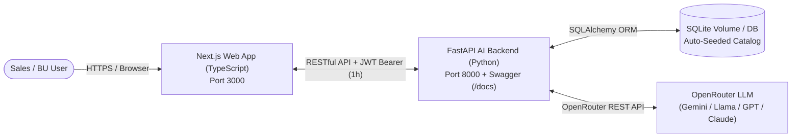
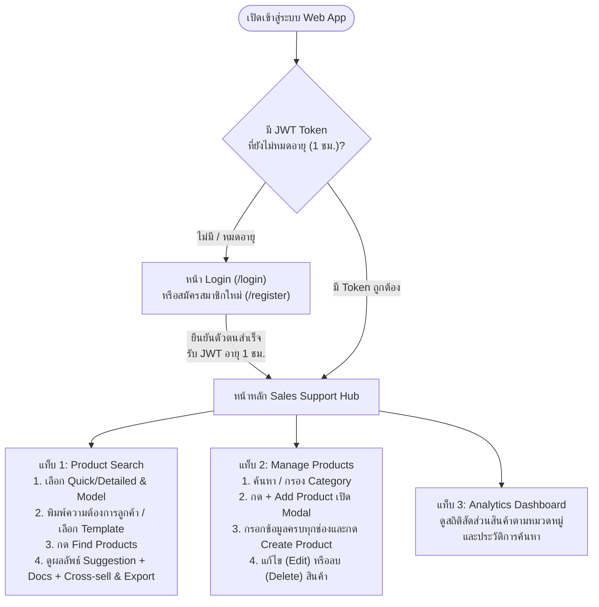

# คู่มือ Pitching รอบสัมภาษณ์ 10 นาที & เจาะลึกคำถามเทคนิค Docker / DevSecOps

เอกสารนี้สรุปเนื้อหาสำหรับใช้นำเสนอ (Pitching ไม่เกิน 10 นาที) ตามหัวข้อที่กำหนดในข้อสอบข้อที่ 5 พร้อมแนวคำตอบสำหรับคำถามเทคนิค Docker และ DevSecOps

---

## ส่วนที่ 1: สคริปต์ Pitching 10 นาที (5 หัวข้อบังคับ)

### 1. As-Is Vs To-Be (นาทีที่ 0:00 – 2:00)

| มิติการเปรียบเทียบ | As-Is (รูปแบบการทำงานเดิมของทีม Sales / BU) | To-Be (เมื่อใช้ AI Sales Support Hub) |
| :--- | :--- | :--- |
| **การค้นหาสินค้า** | ต้องเปิดหาจากไฟล์ PDF/Excel หลายแฟ้ม ใช้เวลาค้นหาและเทียบสเปกนาน | พิมพ์ความต้องการลูกค้าด้วยภาษาธรรมชาติ (Natural Language) AI จับคู่สินค้าพร้อมคะแนนความเหมาะสม (% Match) ทันที |
| **เอกสารอ้างอิง (Validation & Publications)** | ต้องทักถามทีม Product Specialist หรือค้นหา Validation Report แยกต่างหาก ทำให้ตอบลูกค้าช้า | ระบบแนะนำ **Supporting Documents** (Validation Reports & Publications) ที่ผูกกับสินค้านั้นให้อัตโนมัติ |
| **การขายพ่วง (Cross-selling)** | พนักงานขายอาจลืมแนะนำสินค้าที่ใช้คู่กัน ทำให้เสียโอกาสเพิ่มมูลค่าใบเสนอราคา | ระบบวิเคราะห์และชี้เป้า **Cross-selling** พร้อมเหตุผลในการเสนอขายคู่กันทันที |
| **การอัปเดต Catalog** | ข้อมูลกระจัดกระจาย อัปเดตยาก | มีหน้า **Manage Products (CRUD)** ที่ทีม BU เพิ่ม/ลบ/แก้ไขสินค้าผ่านหน้าเว็บแล้ว AI นำไปใช้แนะนำต่อได้ทันที |

---

### 2. Architecture ของระบบ (นาทีที่ 2:00 – 4:00)



* **Frontend Layer:** พัฒนาด้วย **Next.js 14 (TypeScript)** มี Middleware ตรวจสอบ JWT Cookie และแนบ Bearer Token ทุกครั้งที่เรียก API
* **Backend & Security Layer:** พัฒนาด้วย **Python (FastAPI)** มี Swagger UI ที่ `/docs`, เข้ารหัสรหัสผ่านด้วย **bcrypt** (ไม่เก็บ Plain Text), ออก JWT Token อายุ **1 ชั่วโมง (3,600 วินาที)** และบังคับตรวจ Token ผ่าน `Depends(get_current_user)` ทุก Route
* **AI Inference Layer:** เชื่อมต่อ **OpenRouter API** ส่งข้อมูล Product Catalog ปัจจุบันเป็น Context (RAG/In-Context) เพื่อให้ AI ตอบกลับเป็น JSON ที่มีโครงสร้างชัดเจน พร้อมระบบ Smart Fallback กรณีไม่ได้ใส่ API Key เพื่อให้รันทดสอบได้ทุกสภาพแวดล้อม
* **Container & DevSecOps Layer:** ห่อหุ้มด้วย **Docker Multi-stage Build** รันด้วยคำสั่งเดียว `docker compose up --build` และตรวจสอบความปลอดภัยผ่าน GitHub Actions ครบทั้ง **SCA, SAST, IaC และ DAST**

---

### 3. Feature ของระบบ (นาทีที่ 4:00 – 6:00)

1. **AI-Powered Product Search (3 แกนหลักตามรูปที่ 1 และ 2):**
   * **Product Suggestion:** แนะนำผลิตภัณฑ์ที่ตรงกับโจทย์ลูกค้า พร้อมคะแนน Match Score และ Key Benefits
   * **Supporting Documents:** แนะนำเอกสาร Validation Reports และงานวิจัย (Publications) เพื่อสร้างความมั่นใจให้ลูกค้า
   * **Cross-selling:** แนะนำสินค้าพ่วงหรืออุปกรณ์เสริมที่ใช้ร่วมกันได้
   * รองรับโหมด `Quick Search` / `Detailed Search`, การเลือกโมเดล AI (`Model Selector`), ประวัติการค้นหา (`History`), เทมเพลตคำถาม (`Templates`) และการส่งออกผลลัพธ์ (`Export Results`)
2. **Product Portfolio Management (Manage Products ตามรูปที่ 3):**
   * เพิ่ม/แก้ไข/ลบสินค้าผ่าน Modal ที่ตรวจสอบความถูกต้องของข้อมูล (เช่น `Description` ต้องมีอย่างน้อย 10 ตัวอักษร)
   * ค้นหาสินค้าตามชื่อ/แบรนด์/คำอธิบาย และกรองตามหมวดหมู่ (`Category Filter`) รวมถึงลบหลายรายการพร้อมกัน (`Bulk Delete`)
3. **Analytics Dashboard:**
   * แสดงภาพรวมจำนวนสินค้าแยกตามหมวดหมู่ แบรนด์ จำนวนเอกสารอ้างอิง และสถิติการค้นหาด้วย AI
4. **Enterprise Authentication & Route Protection:**
   * ระบบ Register (`Username`, `Email`, `Password` เข้ารหัส `bcrypt`) และ Login ที่ออก JWT Token อายุ 1 ชั่วโมง

---

### 4. User Story (นาทีที่ 6:00 – 8:00)

* **User Story ที่ 1 (Sales Specialist):**
  > *"ในฐานะ **Sales Specialist** เมื่อลูกค้าแจ้งความต้องการทางเทคนิค (เช่น ต้องการระบบโครมาโทกราฟีแบบ Single-Use สำหรับผลิตยาชีววัตถุระดับ GMP) ฉันต้องการพิมพ์โจทย์ลงในระบบด้วยภาษาธรรมชาติ เพื่อให้ระบบแนะนำทั้งสินค้าหลัก (`DynaChrom system`), เอกสาร Validation Report และสินค้าพ่วง (`MabSelect PrismA Column` และ `Advantec PES Filter`) ภายในไม่กี่วินาที ทำให้ฉันตอบลูกค้าได้อย่างแม่นยำและปิดการขายได้เร็วขึ้น"*
* **User Story ที่ 2 (BU Product Specialist / Manager):**
  > *"ในฐานะ **Product Specialist ของทีม BU** ฉันต้องการหน้าจัดการสินค้า (Manage Products) ที่สามารถเพิ่ม แก้ไข หรือลบสินค้าใน Catalog ได้ด้วยตัวเองผ่านเว็บแอปพลิเคชัน เพื่อให้ข้อมูลสินค้าที่ AI นำไปใช้วิเคราะห์เป็นข้อมูลล่าสุดอยู่เสมอโดยไม่ต้องพึ่งทีมนักพัฒนา"*
* **User Story ที่ 3 (Security / DevOps Engineer):**
  > *"ในฐานะ **ผู้ดูแลระบบ** ฉันต้องการให้ระบบบังคับยืนยันตัวตนด้วย JWT ที่มีอายุ 1 ชั่วโมง เก็บรหัสผ่านแบบ Hash และผ่านการสแกน SCA, SAST, DAST, IaC อัตโนมัติทุกครั้งก่อนนำขึ้นระบบจริง"*

---

### 5. UI Flow (นาทีที่ 8:00 – 10:00)



---

## ส่วนที่ 2: เกร็งคำถาม-คำตอบเทคนิค Docker & DevSecOps (สำหรับการสัมภาษณ์)

> ข้อสอบระบุชัดเจนว่า: *"จะต้อง Deploy ผ่าน Docker Container ซึ่งผู้ตรวจสามารถรัน Web Application ได้ภายในคำสั่งเดียว (หากไม่มี Container จะถือว่าตกสัมภาษณ์) และจะมีคำถามเทคนิคของ Docker โดยเฉพาะ"*

### Q1: ทำไมถึงใช้ Multi-stage Build ทั้งใน `backend/Dockerfile` และ `frontend/Dockerfile`?
* **คำตอบ:**
  * เพื่อแยก Stage สำหรับการ Compile/Build (ซึ่งต้องใช้เครื่องมือขนาดใหญ่อย่าง `gcc`, `pip wheel`, หรือ `node_modules` ทั้งหมดตอน Build Next.js) ออกจาก Stage สำหรับรันจริง (`runner`)
  * ใน `frontend/Dockerfile` เราตั้งค่า `output: "standalone"` ใน `next.config.mjs` ทำให้ Stage สุดท้ายคัดลอกเฉพาะไฟล์ `server.js` และ Dependencies ที่จำเป็นจริงๆ ส่งผลให้ขนาด Docker Image เล็กลงกว่า 70% และลด Attack Surface (ไม่มี Build Tools เหลือให้ผู้โจมตีใช้ใน Production Container)

### Q2: ใน `Dockerfile` มีการป้องกันด้าน Security อะไรบ้าง (เกี่ยวข้องกับ IaC Scan อย่างไร)?
* **คำตอบ:**
  1. **Non-root User:** โดยปกติ Docker Container จะรันด้วย `root` ซึ่งเสี่ยงต่อการเกิด Container Breakout เราจึงสร้าง User เฉพาะ (`appuser` ใน Backend และ `nextjs` uid 1001 ใน Frontend) แล้วสั่ง `USER appuser` / `USER nextjs` ก่อนรันโปรเซส
  2. **`no-new-privileges:true`:** ใน `docker-compose.yml` เราใส่ `security_opt: - no-new-privileges:true` เพื่อป้องกันไม่ให้โปรเซสภายใน Container ยกระดับสิทธิ์ตัวเองผ่าน `setuid`/`setgid`
  3. **Slim / Alpine Base Image:** ใช้ `python:3.12-slim` และ `node:20-alpine` เพื่อลดจำนวนแพ็กเกจที่ไม่จำเป็นใน OS

### Q3: รู้ได้อย่างไรว่า Backend พร้อมทำงานก่อนที่ Frontend จะเริ่มเชื่อมต่อไปหา?
* **คำตอบ:**
  * การใช้ `depends_on` เพียงอย่างเดียวจะรอแค่ Container เริ่มรัน (Container Started) แต่ไม่ได้แปลว่า FastAPI พร้อมรับ Request แล้ว
  * เราจึงกำหนด `HEALTHCHECK` ที่ยิงตรวจ `http://127.0.0.1:8000/api/health` และใน `docker-compose.yml` ใช้:
    ```yaml
    depends_on:
      backend:
        condition: service_healthy
    ```
    เพื่อให้ Docker รอจนกว่า FastAPI จะสร้างตารางและ Seed ข้อมูลเสร็จจนตอบกลับ `200 OK` ก่อนจึงค่อยสตาร์ท Frontend

### Q4: ข้อมูลใน Database จะหายไหมถ้าสั่ง `docker compose restart`?
* **คำตอบ:**
  * **ไม่หาย** เพราะเราผูก Named Volume ชื่อ `backend_data:/app/data` ไว้ใน `docker-compose.yml` โดยเก็บไฟล์ฐานข้อมูลไว้ที่ `/app/data/sales_support.db` ข้อมูลผู้ใช้และสินค้าที่เพิ่ม/แก้ไขจะคงอยู่แม้จะปิดและเปิด Container ใหม่ (ยกเว้นจะสั่งลบ Volume ด้วย `docker compose down -v`)

### Q5: อธิบายความแตกต่างของ SCA, SAST, DAST และ IaC ที่ตั้งค่าไว้ในโปรเจกต์นี้?
* **คำตอบ:**
  1. **SCA (Software Composition Analysis):** ตรวจสอบช่องโหว่ (CVE) ของ **Open-source Libraries / Third-party Packages** ที่เรานำมาใช้ เช่นใน `requirements.txt` และ `package.json` (ใช้ **Trivy FS Scan** และ **pip-audit**)
  2. **SAST (Static Application Security Testing):** ตรวจสอบ **Source Code ที่เราเขียนเอง** โดยไม่ต้องรันโปรแกรม เพื่อหาจุดเสี่ยง เช่น Hardcoded Secret, SQL Injection, XSS (ใช้ **Bandit** สำหรับ Python และ **Semgrep** สำหรับ Python/TypeScript)
  3. **IaC (Infrastructure as Code Scanning):** ตรวจสอบไฟล์โครงสร้างพื้นฐาน เช่น `Dockerfile` และ `docker-compose.yml` ว่าตั้งค่าปลอดภัยหรือไม่ เช่น ลืมตั้ง Non-root user หรือไม่มี Healthcheck (ใช้ **Trivy Config Scan**)
  4. **DAST (Dynamic Application Security Testing):** ทดสอบเจาะระบบจากภายนอก (Black-box) **ขณะที่แอปพลิเคชันกำลังรันอยู่จริงบน Docker** เพื่อตรวจหา Security Headers ที่ขาดหายหรือช่องโหว่ HTTP จริง (ใช้ **OWASP ZAP Baseline Scan**)
